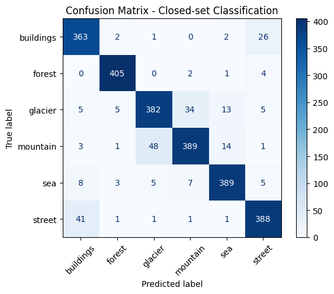
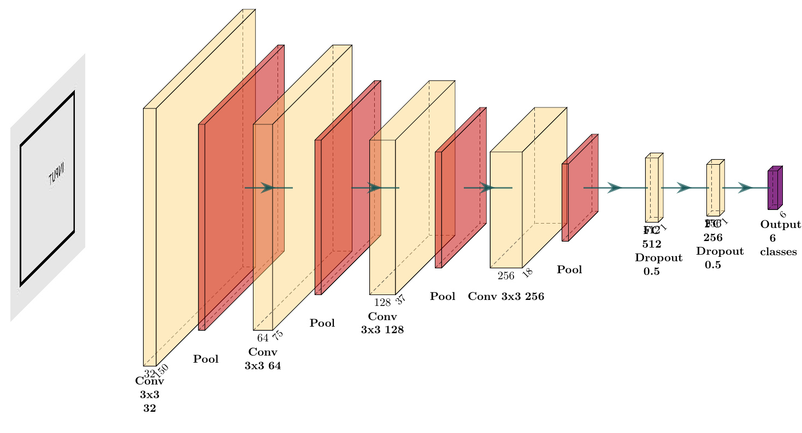
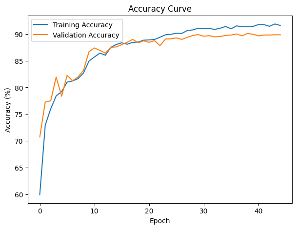
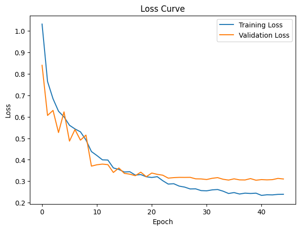
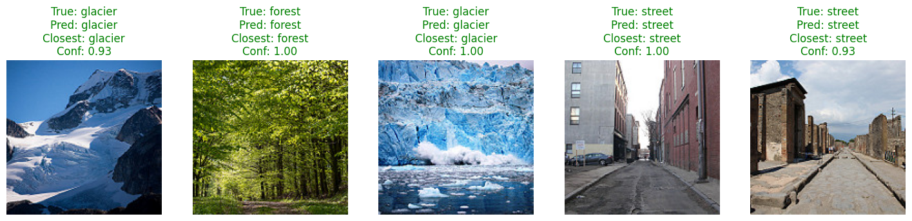

# CNN Scene Classification

Computer Vision course project developed with **PyTorch**. We trained a convolutional neural network from scratch to classify natural scenes into six categories: **buildings, forest, glacier, mountain, sea and street**.

## Results

The final run reached **89.86% validation accuracy** and **90.61% closed-set test accuracy**. Most errors appear between visually similar classes, especially **buildings / street** and **glacier / mountain**.



## Approach

The notebook uses a stratified **70/15/15 train/validation/test split**. Images are resized to **150 × 150**, normalized, and augmented during training with horizontal flips, small rotations and color jitter.

The CNN has four convolutional blocks with **32, 64, 128 and 256 filters**, followed by adaptive average pooling and fully connected layers with dropout. Training uses **CrossEntropyLoss**, **AdamW**, learning-rate reduction on validation loss and early stopping.



### Training curves

| Accuracy | Loss |
| --- | --- |
|  |  |

## Confidence-based rejection

The notebook also includes a simple rejection rule for uncertain predictions. If the maximum softmax probability is below the selected threshold, the prediction is returned as **`None of the above`** instead of forcing one of the six classes.

This is a confidence-based rejection rule, not a full open-set recognition model.

## Example predictions



## Repository structure

```text
cnn-scene-classification/
├── assets/
│   ├── accuracy_curve.png
│   ├── cnn_architecture.png
│   ├── confusion_matrix.png
│   ├── loss_curve.png
│   └── predictions.png
├── notebooks/
│   └── scene_classification.ipynb
├── .gitignore
├── README.md
└── requirements.txt
```

## Running the notebook

The dataset is downloaded directly in the notebook using `kagglehub`, so the CSV and image dataset are not included in the repository.

```bash
pip install -r requirements.txt
jupyter notebook notebooks/scene_classification.ipynb
```

## Authors

Developed by **Isabel Gregorio Díez** and **Carlota Campos Rubio**.

During training, model checkpoints are written to `outputs/`, which is ignored by Git.

## Tech stack

Python, PyTorch, Torchvision, scikit-learn, Pandas, NumPy, Matplotlib, Pillow and KaggleHub.
